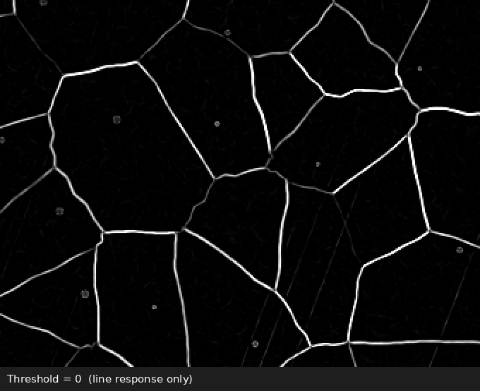
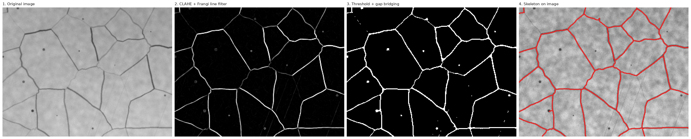

# Interactive Crack Detection for Microscope Images

A tool for detecting and measuring crack networks in microscope images of coatings. You tune the detection **interactively with sliders and see the result live**, save the settings, and then apply exactly the same settings to a whole folder of images to get crack length and crack density for each one.



**Skills shown:** image processing with OpenCV and scikit-image · Frangi vesselness filter · morphology and skeletonization · interactive GUI · reproducible batch processing · validation against ground truth · synthetic test data

---

## Why

Cracks in optical micrographs are hard to segment automatically: some are only one or two pixels wide, some are faint, the illumination is uneven, and pits, grain texture and polishing scratches look similar to cracks. No fixed set of parameters works for every sample and microscope setting. This tool makes finding good parameters fast and visual, and keeps the analysis reproducible once they are found.

## How it works



| Step | What it does | Slider |
|---|---|---|
| 1. Contrast enhancement | CLAHE (local histogram equalisation) evens out the illumination | CLAHE x10 |
| 2. Line filter | **Frangi** vesselness filter (multi-scale, finds tube-like dark structures) or morphological **black-hat** | Method |
| 3. Gain | Strengthens the filter response, to bring out faint cracks | Line Strength |
| 4. Threshold | Turns the response into a binary crack mask | Threshold |
| 5. Gap bridging | Morphological closing joins crack pieces separated by small gaps | Gap Bridge |
| 6. Skeleton + length filter | Thins cracks to one pixel and removes short pieces such as pits and noise | Min Length |
| 7. Measurement | Crack count, total length and density (length per area), in pixels or µm | |

The slow steps (Frangi filter, skeletonization) are cached, so the viewer reacts immediately when you move a slider.

## Usage

```bash
pip install -r requirements.txt
python make_demo_images.py                        # creates synthetic test images in demo/
python crack_viewer.py demo/sample_01.png --um-per-px 0.217
```

Two windows open: **Controls** with the sliders and **Crack Viewer** with the result and the live measurements. The **View** slider switches between the original image, the line response, the binary mask, and the cracks drawn on the image.

| Key | Action |
|---|---|
| `s` | Save overlay, mask, skeleton, measurements and settings to `results/` |
| `r` | Reset all sliders to the default settings |
| `q` / `Esc` | Quit |

### Batch processing

Once the settings are good, apply them to a whole folder:

```bash
python batch_process.py demo --params results/sample_01_params.json --um-per-px 0.217
```

This writes an overlay image per input and `batch_results/measurements.csv`:

| image | cracks | length_um | density_per_um | precision | recall | f1 |
|---|---|---|---|---|---|---|
| sample_01.png | 1 | 2084.9 | 0.0410 | 0.988 | 0.958 | 0.973 |
| sample_02.png | 2 | 2019.8 | 0.0397 | 0.978 | 0.883 | 0.928 |
| sample_03.png | 1 | 2135.7 | 0.0420 | 0.996 | 0.895 | 0.943 |

(`cracks` counts connected crack networks: in these images almost all cracks are joined into one network.)

## Validation on synthetic images

Real micrographs from the lab where I developed this tool cannot be published, so `make_demo_images.py` generates realistic test images instead. They have uneven illumination, nodular texture, noise, dark pits, polishing scratches, and a crack network built from a Voronoi diagram with cracks of different widths and contrast, including faint ones. Because the true crack positions are known, every detection can be checked.

With the default settings, the detected cracks agree with the ground truth with **F1 between 0.93 and 0.97** (within 2 pixels): almost no false detections (precision 0.98–1.00), and 88–96% of the crack length found. The missed parts are mainly the faintest cracks.

If you have hand-traced masks for real images, name them `<image>_truth.png` and `batch_process.py` reports precision, recall and F1 for them too.

## Project structure

```
interactive-crack-detection/
├── crack_pipeline.py      # all image processing and measurements (no GUI)
├── crack_viewer.py        # interactive viewer with sliders
├── batch_process.py       # apply saved settings to a folder, export CSV
├── make_demo_images.py    # synthetic test images with ground truth
├── demo/                  # generated sample images and ground-truth masks
├── images/                # figures for this README
├── requirements.txt
└── LICENSE
```

Keeping the processing in `crack_pipeline.py`, separate from the interface, means the viewer and the batch mode always give identical results for the same settings.

## Limitations

* Synthetic images are cleaner than many real micrographs, so real images usually need more tuning, and the validation numbers above should not be read as accuracy on real samples.
* Crack length is measured on the skeleton at the processing scale (default 0.5) and converted back to the original resolution. Very fine details can be lost at lower scales.
* Settings are tuned by eye. For many very different images, a learning-based segmentation trained on annotated images may be more robust.

## Context

Developed while working on automated crack analysis of microscope images of electroplated coatings. Only the code is published here.

## License

[MIT](LICENSE)
